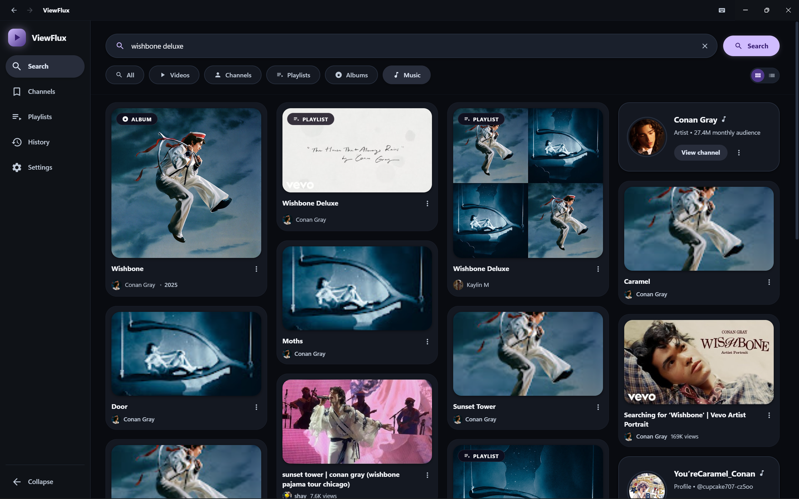
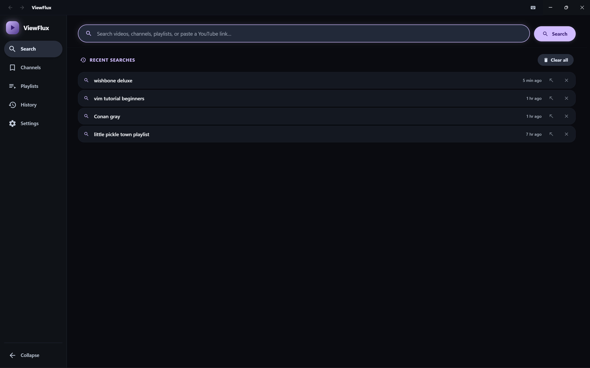
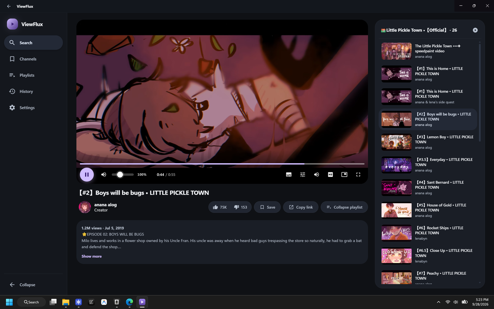
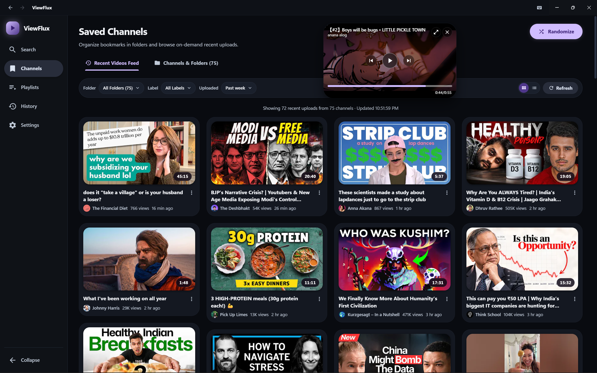
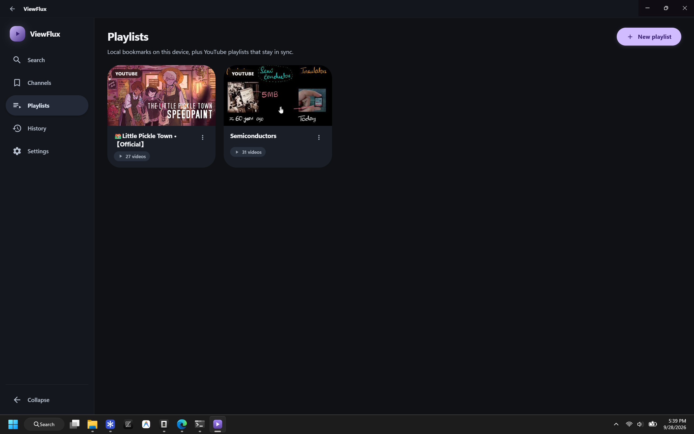
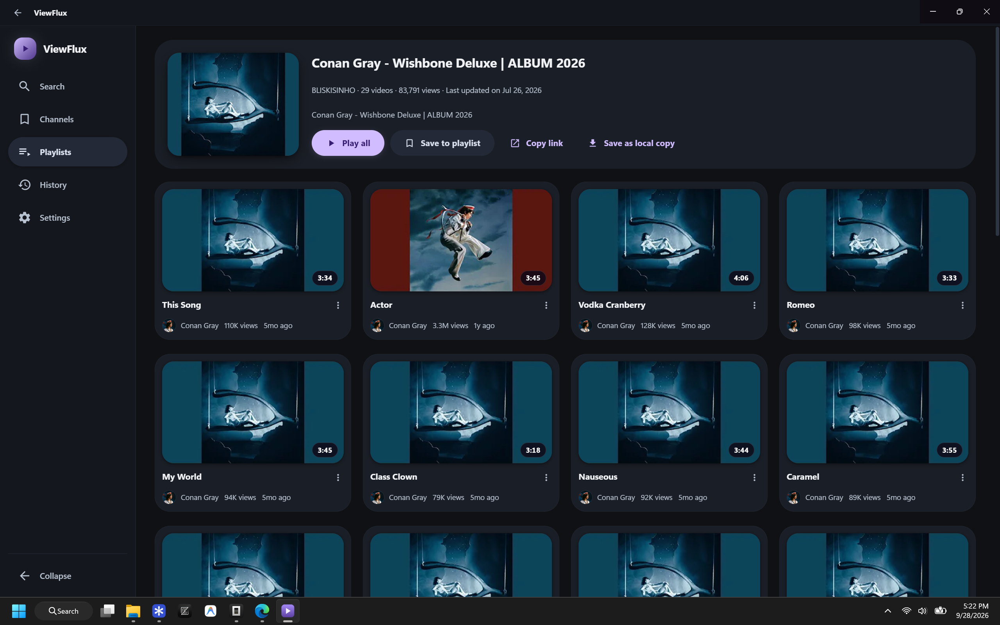
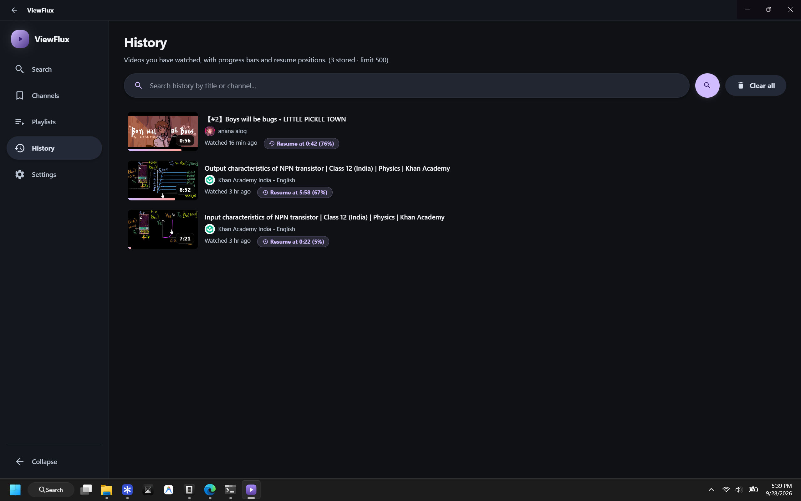
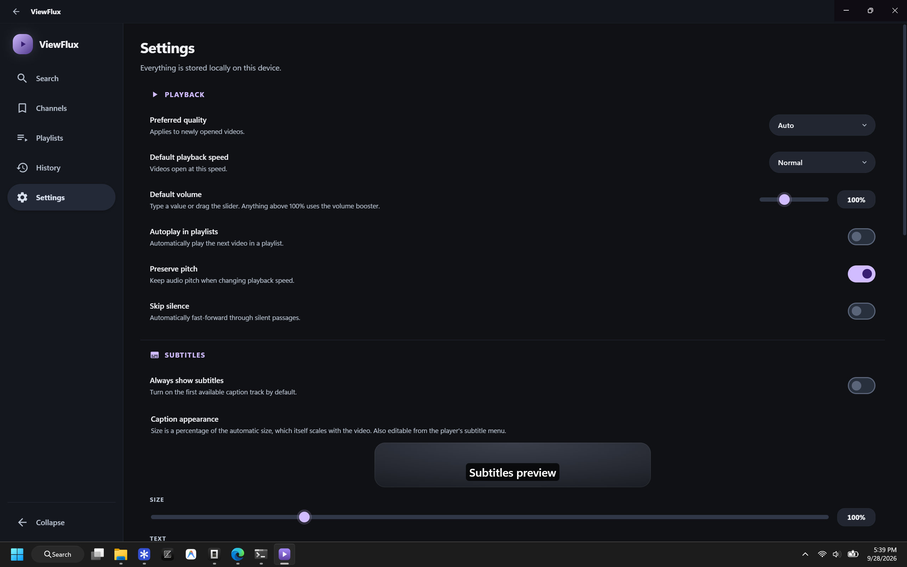

# ViewFlux Desktop

A fast, native desktop YouTube client for **Windows**, **Linux**, and **macOS** focused on one thing: **searching for and watching videos**.
It is a modern, lightweight desktop client inspired by [LibreTube](https://github.com/libre-tube/LibreTube) —
no distracting algorithmic feeds, no recommendation loops, no trending. Just search, a high-quality adaptive player, SponsorBlock,
channel bookmarks with folders and tags, playlist management, and watch history.

Built with **Electron + Vite + React + TypeScript**, extracting data with
[`youtubei.js`](https://github.com/LuanRT/YouTube.js) and playing back adaptive streams with
[Shaka Player](https://github.com/shaka-project/shaka-player).

---

## Screenshots

<table>
  <tr>
    <td width="50%" valign="top">
      
      <br /><sub><b>Search</b> — videos, channels, playlists and YouTube Music in one grid, with filter chips, live suggestions and infinite scroll.</sub>
    </td>
    <td width="50%" valign="top">
      
      <br /><sub><b>Recent searches</b> — search history with quick query reuse, per-item deletion and one-click clear all.</sub>
    </td>
  </tr>
  <tr>
    <td width="50%" valign="top">
      
      <br /><sub><b>Watch</b> — adaptive DASH playback with the M3 control bar, customisable subtitles and the playlist queue.</sub>
    </td>
    <td width="50%" valign="top">
      
      <br /><sub><b>Saved channels</b> — bookmark channels into folders and labels, then browse an on-demand recent uploads feed.</sub>
    </td>
  </tr>
  <tr>
    <td width="50%" valign="top">
      
      <br /><sub><b>Playlists</b> — local bookmarks on this device, plus YouTube playlists that stay in sync with the source.</sub>
    </td>
    <td width="50%" valign="top">
      
      <br /><sub><b>YouTube playlist</b> — play it all, keep it as a live reference, or copy it into a local playlist.</sub>
    </td>
  </tr>
  <tr>
    <td width="50%" valign="top">
      
      <br /><sub><b>History</b> — recorded automatically, with progress bars, resume positions and search by title or channel.</sub>
    </td>
    <td width="50%" valign="top">
      
      <br /><sub><b>Settings</b> — playback, subtitle and appearance preferences, stored locally on this device.</sub>
    </td>
  </tr>
</table>

---

## Features

- **Search** — results across **videos, channels, playlists, and YouTube Music**, with
  All / Videos / Channels / Playlists / Music filter chips; live search suggestions; infinite
  scroll (continuation); **search history** with configurable storage limits, reuse, per-item delete, and clear-all.
- **Proof of Origin (PO) Tokens & Playback Integrity** — native BotGuard VM execution via an authentic, isolated offscreen Chromium runtime; produces 12-hour Google Web App Attestation (WAA) tokens with zero heavy third-party emulators. Features an instant (<0.1ms) synthetic cold-start fallback for zero startup lag, an LRU token cache, deterministic 403 Forbidden recovery with auto-refresh in the media proxy, and optional external HTTP provider or manual token overrides.
- **Channels** — open any channel from search or the watch page: banner, avatar, handle and
  subscriber count; Videos / Releases / Playlists / About tabs (only the ones the channel actually
  has); native server-side video sorting (Newest, Most popular, Oldest) and public channel playlists
  (openable as remote playlists).
- **Music channels** — music channels are flagged with YouTube's note logo next to the channel name,
  on both the channel page and in search results, and get a **Releases** tab listing their albums and
  EPs with square cover art, artist and release year. Official Artist Channels serve that tab from
  their `/releases` route; auto-generated "- Topic" channels have no such route, so their discography
  is read from the "Albums & Singles" shelf on the channel home page. An album opens and plays like
  any other YouTube playlist, so **Play all** and the in-page queue work straight from the channel page.
- **Saved Channels & Recent Videos Feed** — bookmark channels into custom folders and tags/labels; browse an
  on-demand recent uploads feed filtered by folder, label, and recency window (past 24h, past week, past month).
- **High-quality player** — DASH adaptive streaming (up to 2160p) with a
  Material 3 Expressive control bar: play/pause, a full-width seek bar with buffered +
  SponsorBlock markers and hover time preview, volume with a live percentage readout, video
  quality, **audio track selection (original audio selected by default)** plus audio bitrate,
  **customizable subtitles** (track selection plus size, colour and background — from the captions
  menu or Settings, with a live preview) that automatically lift above the control bar when it appears,
  single-video **Loop toggle**, Picture-in-Picture, fullscreen, and keyboard shortcuts. A playback
  sheet offers **speed presets + editable slider**, **preserve-pitch toggle**, and **Skip
  Silence** (real-time silence detection that speeds through quiet passages and restores when
  audio resumes). Every menu is an **adaptive popover** — it opens where there is room and
  closes on outside click or Escape.
- **Playlist Sidebar** — independent scrolling sidebar with its own isolated scroll container,
  automatic scroll-to-active item, and collapsible layout.
- **Player Diagnostics & Debug Console** — real-time floating playback diagnostic trace recording events from `SHAKA`, `PROXY`, `MANIFEST`, `WATCHDOG`, `MEDIA`, `RECOVERY`, and `POTOKEN` subsystems with level badges, filtering, JSON payload inspection, and one-click copy to clipboard.
- **Video information** — title, channel avatar + name (clickable → channel page), views,
  publish date, description with its original line breaks, and **Return YouTube Dislike** counts.
- **SponsorBlock** — automatic skipping of sponsor/self-promo/interaction/intro/outro/preview/filler
  segments, with per-category toggles and an **Undo** toast when a segment is skipped.
- **Playlists — local and YouTube** — create/rename/delete local playlists, add/remove videos,
  reorder items, and play a whole playlist with an in-page queue. Any YouTube playlist can be
  **saved to the Playlists section**; it stays a live reference (name, count, and items re-synced
  from YouTube each time you open it, with a manual "Sync now" action) and can be copied into a
  local playlist.
- **History** — watch history is recorded automatically with a clear visual progress bar and resume position pill;
  searchable by title and author; configurable capacity limits (100–5000 entries); can be switched off and cleared
  in Settings.
- **Material 3 Expressive UI** — polished dark theme with seven accent palettes, springy motion,
  expressive rounded shapes, responsive layout, and carefully designed settings, menus, and dialogs.
- **Layout** — a **collapsible sidebar** (narrow icon rail when collapsed, remembered between
  launches), full-width content areas for search / channels / playlists / history / settings, filter chips
  that only appear once something is searched, and expandable video descriptions.

## How it works (architecture)

```
┌────────────────────────────────────────────── Electron main process ──────────────────────────────────────────────┐
│  youtubei.js (Innertube Engine)                 PoTokenService (BotGuard & Integrity Engine)                      │
│   • Search, suggestions, channel, playlists      • Native offscreen Chromium BotGuard minter                      │
│   • getBasicInfo with PO token injection         • Google Web Account Authenticator (WAA) GenerateIT flow         │
│   • toDash() → MPD manifest generation           • Zero-lag cold-start fallback & LRU token cache                 │
│                                                                                                                   │
│  MediaProxy (127.0.0.1, random port)            Store & External Integrations                                     │
│   • /media   → Range/206 passthru + &pot=        • Atomic JSON persistence in userData                            │
│   • Automatic 403 Forbidden token recovery retry • SponsorBlock skip segments & ReturnYouTubeDislike stats        │
│   • /manifest→ generated DASH MPD manifest       • Real-time diagnostic event bus logging                         │
│   • /captions→ json3 → WebVTT conversion                                                                          │
└───────────────────────────────────────────────────────┬───────────────────────────────────────────────────────────┘
                                             contextBridge (ipcRenderer.invoke)
┌───────────────────────────────────────────────────────┴───────────────────────────────────────────────────────────┐
│  React 19 Renderer (Search · Watch · Channels · Playlists · History · Settings)                                   │
│   • Shaka Player decodes the local proxy DASH MPD stream                                                          │
│   • Player Diagnostics & Debug Console surfaces live pipeline logs (POTOKEN, PROXY, MANIFEST, SHAKA, WATCHDOG)   │
└───────────────────────────────────────────────────────────────────────────────────────────────────────────────────┘
```

### Proof of Origin (PO) Tokens & Playback Integrity

YouTube requires a cryptographic "Proof of Origin" (PO) token for media extraction and chunk streaming to guard against automated scraping and playback abuse. Without a valid PO token, stream requests are either heavily throttled or rejected outright with `403 Forbidden`.

ViewFlux Desktop solves this natively without requiring external proxies or bundled Python environments:

1. **Native Chromium BotGuard Minter** — ViewFlux executes Google's Web Account Authenticator (`WAA`) script inside an isolated, offscreen Electron `webContents` environment. Because this environment runs full Chromium with authentic DOM APIs and canvas rendering, it mints valid 12-hour session tokens that match genuine desktop browser behavior.
2. **Instant Zero-Lag Cold Start** — While the background BotGuard VM asynchronously loads and initializes, ViewFlux provides an immediate synthetic integrity token so video metadata and initial playback resolve with zero latency.
3. **Transparent MediaProxy with 403 Auto-Recovery** — All media chunks flow through the local streaming proxy on `127.0.0.1`. The proxy enforces exact `googlevideo.com` headers (`Referer`, `Origin`, and `User-Agent`), appends fresh `&pot=` tokens to chunk URLs, and automatically detects any upstream `403 Forbidden` response. When a token expires or is rejected, the proxy invalidates the cache, mints a fresh token, and transparently retries the range request without interrupting playback or stalling the player buffer.
4. **Customizable Token Sources** — Under **Settings → PO Token (Proof of Origin)**, users can choose between:
   - **Automatic (Native BotGuard VM)** — Default; zero-configuration background minting.
   - **External Generator** — Connects to any local or remote PO token server (e.g., `yt-dlp` token servers or custom microservices).
   - **Manual Token** — Allows power users to pin custom `po_token` and `visitor_data` strings.
   - **Disabled** — For testing or unauthenticated extraction profiles.

The local proxy exists because googlevideo stream URLs must be requested with matching
`Referer`/`Origin`/`User-Agent` headers, and because the renderer needs a same-origin source for the generated
DASH manifest and caption tracks.

## Requirements

- Windows 10/11 (x64), Linux (x64/arm64), or macOS (x64/arm64)
- Node.js 20+ and npm (for development/building)

## Development

```bash
npm install
npm run dev          # electron-vite dev server with hot reload
```

Other useful scripts:

```bash
npm run typecheck    # tsc for both the node (main/preload) and web (renderer) projects
npm run build        # build main, preload and renderer into out/
npm run preview      # preview the production build
npm run icon         # regenerate build/icon.png
```

## Packaging

Packaging scripts are configured via `electron-builder` in `package.json`:

```bash
# Windows
npm run dist         # build + NSIS installer → release/ViewFlux-Setup-<version>.exe
npm run dist:dir     # build + unpacked app only (faster, no installer)

# Linux
npm run dist:linux   # build + AppImage / .deb → release/

# macOS
npm run dist:mac     # build + DMG / .zip → release/

# All platforms (from supported host)
npm run dist:all     # build Windows, Mac, and Linux packages
```

## Data & privacy

All state is stored **locally** in a single JSON file under Electron's `userData` directory
(`viewflux-data.json`, with automated migration from legacy `libretube-data.json`) — nothing is sent to any external server. Outbound requests are limited to
YouTube (for extraction/media), SponsorBlock, and Return YouTube Dislike.

## Known limitations

- Captions depend on the video exposing caption tracks to the `VISIONOS` client; when none exist, the
  caption menu is hidden.
- Subtitles are rendered by the player itself (so they can be styled and repositioned) and therefore do
  not appear in the Picture-in-Picture window, matching YouTube's own web player.
- Live streams play through YouTube's own dynamic DASH manifest (the same source LibreTube prefers) and
  start about 10 s behind the edge, matching YouTube's own player. Whatever rewind window YouTube grants
  the broadcast — up to 4 hours — is scrubbable, and the LIVE badge in the control bar doubles as a
  jump-to-edge button whenever playback drifts behind. Chapters, description timestamps and SponsorBlock
  are disabled while live, since a moving presentation timeline has no fixed positions.
- The music-channel note logo is read from the badge YouTube attaches to a channel name, so it appears on
  Official Artist Channels and "- Topic" channels. Auto-generated topic channels carry no such badge in
  search results, so the logo is missing there. Channels YouTube gives no releases tab and no discography
  shelf get no **Releases** tab. An album page shows the album's own YouTube metadata, which is limited
  to its title, track count and views.

## License & attribution

Licensed under the **GNU General Public License v3.0 or later**.
Not affiliated with or endorsed by YouTube or Google. This is an independent, open-source client,
inspired by [LibreTube](https://github.com/libre-tube/LibreTube), [NewPipe](https://github.com/TeamNewPipe/NewPipe)
and [FreeTube](https://github.com/FreeTubeApp/FreeTube).
